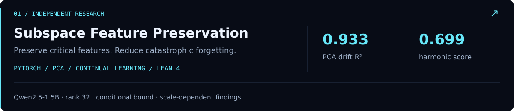
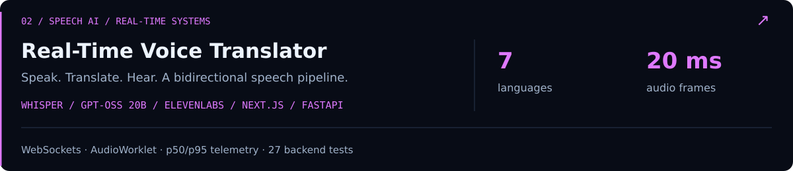
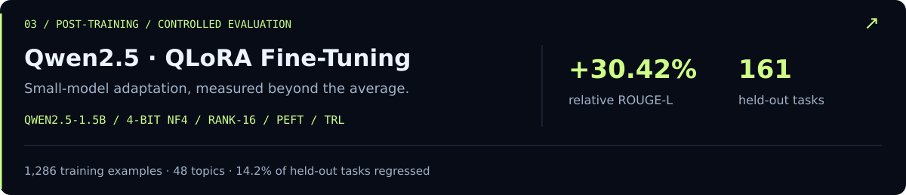
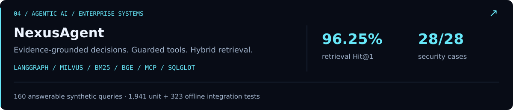
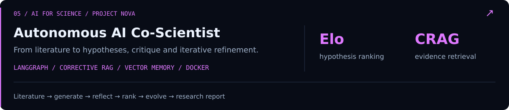
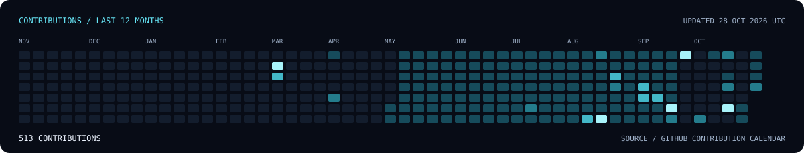

<picture>
  <source media="(prefers-reduced-motion: reduce) and (max-width: 600px)" srcset="assets/hero-mobile.png">
  <source media="(prefers-reduced-motion: reduce)" srcset="assets/hero.png">
  <source media="(max-width: 600px)" srcset="assets/hero-mobile.gif">
  
</picture>

**AI research & engineering · software & cloud systems · GPU & AI infrastructure**

<picture>
  <source media="(max-width: 600px)" srcset="assets/focus-mobile.svg">
  
</picture>

## Selected work

<a href="https://github.com/Akgithub2028/SFP">
<picture>
  <source media="(max-width: 600px)" srcset="assets/sfp-mobile.svg">
  
</picture>
</a>

[Code](https://github.com/Akgithub2028/SFP) · [Paper](https://github.com/Akgithub2028/SFP/blob/main/paper/sfp.pdf) · [Lean proofs](https://github.com/Akgithub2028/SFP/tree/main/lean-sfp)

<a href="https://github.com/Akgithub2028/Real-Time-AI-Voice-Translator">
<picture>
  <source media="(max-width: 600px)" srcset="assets/translator-mobile.svg">
  
</picture>
</a>

[Code](https://github.com/Akgithub2028/Real-Time-AI-Voice-Translator) · [Live demo](https://real-time-ai-voice-translator.vercel.app) · [Latency dashboard](https://real-time-ai-voice-translator.vercel.app/status)

<a href="https://github.com/Akgithub2028/qwen-domain-finetuning">
<picture>
  <source media="(max-width: 600px)" srcset="assets/qlora-mobile.svg">
  
</picture>
</a>

[Code & study](https://github.com/Akgithub2028/qwen-domain-finetuning) · [Evaluation results](https://github.com/Akgithub2028/qwen-domain-finetuning/tree/main/results)

<a href="https://github.com/Akgithub2028/NexusAgent-Enterprise-Autonomous-Multi-Agent-Decision-Intelligence-Platform">
<picture>
  <source media="(max-width: 600px)" srcset="assets/nexus-mobile.svg">
  
</picture>
</a>

[Code](https://github.com/Akgithub2028/NexusAgent-Enterprise-Autonomous-Multi-Agent-Decision-Intelligence-Platform) · [Architecture](https://github.com/Akgithub2028/NexusAgent-Enterprise-Autonomous-Multi-Agent-Decision-Intelligence-Platform/blob/main/docs/ARCHITECTURE.md) · [Benchmark evidence](https://github.com/Akgithub2028/NexusAgent-Enterprise-Autonomous-Multi-Agent-Decision-Intelligence-Platform/tree/main/artifacts/public-evaluation)

<a href="https://github.com/Akgithub2028/Autonomous-AI-Co-Scientist">
<picture>
  <source media="(max-width: 600px)" srcset="assets/coscientist-mobile.svg">
  
</picture>
</a>

[Code & research workflow](https://github.com/Akgithub2028/Autonomous-AI-Co-Scientist)

## Competition

<picture>
  <source media="(max-width: 600px)" srcset="assets/competition-mobile.svg">
  
</picture>

  <b>JEE Main</b> top 0.29% &nbsp; / &nbsp; <b>JEE Advanced</b> top 3.2% &nbsp; / &nbsp; <b>WBJEE</b> top 0.20%

## Contribution signal

<picture>
  <source media="(max-width: 600px)" srcset="profile/signal-mobile.svg">
  
</picture>

  <picture>
    <source media="(max-width: 600px)" srcset="assets/footer-mobile.svg">
    
  </picture>

