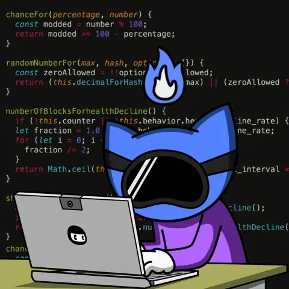

<picture>
  <source media="(prefers-reduced-motion: reduce)" srcset="assets/coding-illustration.png">
  
</picture>

# Aayaann Kausar

**AI research & engineering** 
IIT Kharagpur · Software systems · Cloud & AI infrastructure

I investigate how language models retain and adapt knowledge, and build applications that connect models to speech, documents, and structured data. My current study focuses on **efficient inference, CUDA, Triton, and the infrastructure behind AI systems**.

[LinkedIn](https://linkedin.com/in/aayaann-kausar-8b2813344/) · [Portfolio](https://ak-portfolio-website-two.vercel.app/) &nbsp; 

 

<picture>
  <source media="(prefers-reduced-motion: reduce) and (max-width: 600px)" srcset="profile/signal-mobile.svg">
  <source media="(prefers-reduced-motion: reduce)" srcset="profile/signal.svg">
  <source media="(prefers-color-scheme: light)" srcset="https://raw.githubusercontent.com/Akgithub2028/Akgithub2028/output/pacman-contribution-graph.svg">
  
</picture>

[Research](#research) · [Projects](#selected-projects) · [Technical focus](#technical-focus) · [Competition](#competition)

## Research

### [Subspace Feature Preservation](https://github.com/Akgithub2028/SFP)

**Representation drift as a predictor of catastrophic forgetting.** This study tests whether preserving a small activation subspace can improve retention during sequential language-model fine-tuning.

- **Method:** rank PCA directions by ablation importance, track representation drift, and regularize changes within the selected subspace. The implementation includes controlled baselines and a conditional forgetting bound verified in **Lean 4**.
- **Results:** 32 directions in Qwen2.5-1.5B yield **R² = 0.933** for drift prediction. SFP achieves a **0.699 retention–plasticity harmonic score**, versus 0.631 for LwF; findings vary with model scale.

**Tools:** `PyTorch`, LoRA, PCA, `Lean 4` 
[Paper](https://github.com/Akgithub2028/SFP/blob/main/paper/sfp.pdf) · [Code](https://github.com/Akgithub2028/SFP) · [Formal verification](https://github.com/Akgithub2028/SFP/tree/main/lean-sfp)

## Selected projects

### [Real-Time Voice Translator](https://github.com/Akgithub2028/Real-Time-AI-Voice-Translator)

**Bidirectional speech translation in seven languages**, with bilingual captions, streamed voice playback, and explicit speaker switching.

- **System:** browser `AudioWorklet` capture sends 20 ms PCM frames over WebSockets to a FastAPI pipeline: **Whisper → GPT-OSS 20B → ElevenLabs**. Turn identifiers reject stale responses after interruption.
- **Engineering:** RMS voice-activity detection, 600 ms endpointing, polyphase resampling, and stage-level p50/p95 latency monitoring. Backend validation includes **27 tests**; deployed on Vercel and Render.

**Stack:** `Python`, `FastAPI`, `Next.js`, TypeScript, WebSockets, Web Audio 
[Live demo](https://real-time-ai-voice-translator.vercel.app) · [Latency dashboard](https://real-time-ai-voice-translator.vercel.app/status) · [Code](https://github.com/Akgithub2028/Real-Time-AI-Voice-Translator)

### [Qwen2.5 QLoRA Fine-Tuning](https://github.com/Akgithub2028/qwen-domain-finetuning)

**A controlled study of parameter-efficient domain adaptation**, measuring how fine-tuning changes ML-systems task performance across topics and difficulty levels.

- **Method:** adapt Qwen2.5-1.5B on **1,286 training examples** using 4-bit NF4 and rank-16 adapters. Compare the base and adapted models on the same **161 held-out tasks**, stratified across 48 topics and difficulty tiers.
- **Results:** **30.42% relative ROUGE-L improvement** and BERTScore F1 **0.8187 → 0.8497**. Per-example error analysis documents the **14.2% of examples that regressed**.

**Stack:** `PyTorch`, `PEFT`, `TRL`, QLoRA; ROUGE-L and BERTScore evaluation 
[Code and study](https://github.com/Akgithub2028/qwen-domain-finetuning) · [Evaluation results](https://github.com/Akgithub2028/qwen-domain-finetuning/tree/main/results)

### [NexusAgent](https://github.com/Akgithub2028/NexusAgent-Enterprise-Autonomous-Multi-Agent-Decision-Intelligence-Platform)

**Evidence-grounded decision support across documents and relational data**, with explicit controls around retrieval, SQL execution, and answer review.

- **System:** LangGraph orchestration combines **Milvus + BM25 + reciprocal-rank fusion + BGE reranking** with MCP NL2SQL. SQLGlot validates query syntax trees; read-only scopes and query timeouts bound execution.
- **Validation:** **96.25% retrieval Hit@1** on 160 answerable synthetic queries; **1,941 unit tests**, **323 offline integration tests**, and **28/28 security cases** in the recorded validation snapshot. Security cases overlap the unit suite.

**Stack:** `Python`, `LangGraph`, `FastAPI`, Milvus, MCP, `SQLGlot` 
[Architecture](https://github.com/Akgithub2028/NexusAgent-Enterprise-Autonomous-Multi-Agent-Decision-Intelligence-Platform/blob/main/docs/ARCHITECTURE.md) · [Benchmark evidence](https://github.com/Akgithub2028/NexusAgent-Enterprise-Autonomous-Multi-Agent-Decision-Intelligence-Platform/tree/main/artifacts/public-evaluation) · [Code](https://github.com/Akgithub2028/NexusAgent-Enterprise-Autonomous-Multi-Agent-Decision-Intelligence-Platform)

### [Autonomous AI Co-Scientist](https://github.com/Akgithub2028/Autonomous-AI-Co-Scientist)

**A multi-agent workflow for developing and evaluating research hypotheses**, from literature review through critique and iterative refinement.

- **Workflow:** a supervisor coordinates literature review, hypothesis generation, reflection, **Elo-based ranking**, evolution, and final-report synthesis through asynchronous workers.
- **Architecture:** **corrective RAG** supports evidence retrieval; persistent vector memory carries context between research steps. Hypothesis rankings and reflection feedback guide successive refinement rounds.

**Stack:** `Python`, `LangGraph`, ChromaDB, Docker 
[Code and research workflow](https://github.com/Akgithub2028/Autonomous-AI-Co-Scientist)

## Technical focus

| Area | Tools and topics |
| :--- | :--- |
| **Model research & adaptation** | PyTorch, Transformers, LoRA / QLoRA, PEFT, TRL, Lean 4 |
| **AI applications** | LangGraph, retrieval-augmented generation, MCP, FastAPI, WebSockets, Next.js |
| **Software & cloud systems** | Python, C++, TypeScript, Linux, Docker, Kubernetes, Terraform, CI/CD, AWS, GCP |
| **Current study** | CUDA, Triton, GPU kernels, profiling, and LLM serving |

## Competition

### Wunder Fund — HFT Market State Forecasting

**9th of 5,000+ competitors** · Final R² **0.3920**

Forecasted high-frequency market-state vectors over 1,000-step sequences using a **four-layer, eight-head Transformer** with masked autoencoding and temporal positional encodings. Optimized CPU inference with `torch.compile`, Numba kernels, and preallocated buffers.

Academic achievements

- **JEE Main 2024:** top 0.29%.
- **JEE Advanced 2024:** top 3.2%.
- **WBJEE 2024:** top 0.20%.

