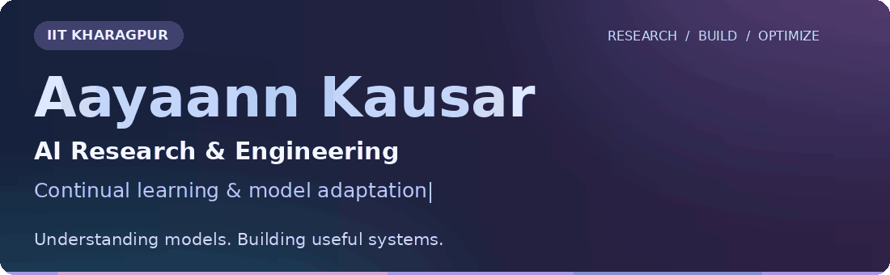
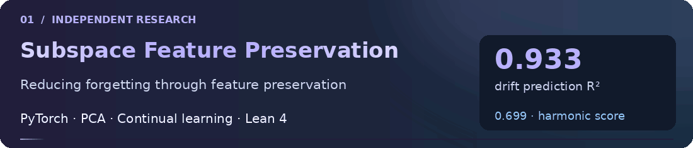
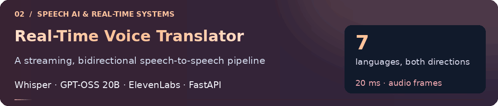
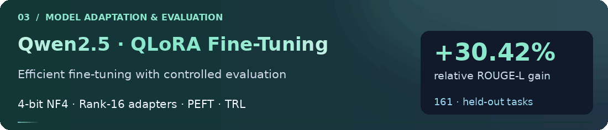
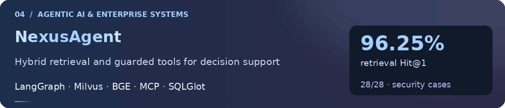
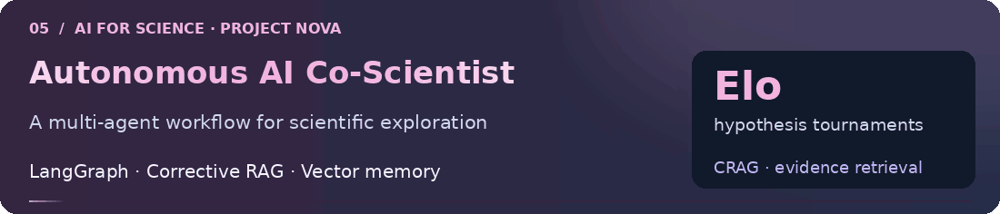
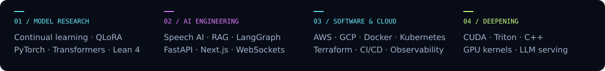
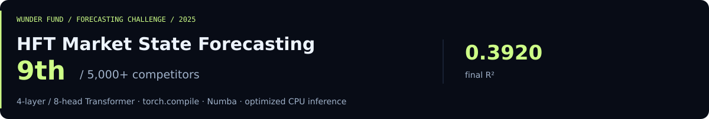

<picture>
  <source media="(prefers-reduced-motion: reduce) and (max-width: 600px)" srcset="assets/hero-mobile.png">
  <source media="(prefers-reduced-motion: reduce)" srcset="assets/hero.png">
  <source media="(max-width: 600px)" srcset="assets/hero-mobile.gif">
  
</picture>

<picture>
  <source media="(prefers-reduced-motion: reduce) and (max-width: 600px)" srcset="profile/signal-mobile.svg">
  <source media="(prefers-reduced-motion: reduce)" srcset="profile/signal.svg">
  <source media="(prefers-color-scheme: light)" srcset="https://raw.githubusercontent.com/Akgithub2028/Akgithub2028/output/pacman-contribution-graph.svg">
  
</picture>

**AI researcher & engineer at IIT Kharagpur.**

I study model behaviour and build AI applications and software systems. 
My growing focus: **cloud infrastructure, efficient inference, CUDA and Triton.**

[Selected work](#selected-work) &nbsp; · &nbsp; [Focus areas](#focus-areas) &nbsp; · &nbsp; [Competition](#competition)

## Selected work

<a href="https://github.com/Akgithub2028/SFP">
<picture>
  <source media="(prefers-reduced-motion: reduce) and (max-width: 600px)" srcset="assets/sfp-mobile.png">
  <source media="(prefers-reduced-motion: reduce)" srcset="assets/sfp.png">
  <source media="(max-width: 600px)" srcset="assets/sfp-mobile.gif">
  
</picture>
</a>

I study how drift in **32 task-critical activation directions** predicts catastrophic forgetting in Qwen2.5-1.5B. The study combines selective feature regularization, controlled baselines and a **conditional forgetting bound verified in Lean 4**, with scale-dependent findings.

[Explore code](https://github.com/Akgithub2028/SFP) · [Read the paper](https://github.com/Akgithub2028/SFP/blob/main/paper/sfp.pdf) · [Inspect Lean proofs](https://github.com/Akgithub2028/SFP/tree/main/lean-sfp)

<a href="https://github.com/Akgithub2028/Real-Time-AI-Voice-Translator">
<picture>
  <source media="(prefers-reduced-motion: reduce) and (max-width: 600px)" srcset="assets/translator-mobile.png">
  <source media="(prefers-reduced-motion: reduce)" srcset="assets/translator.png">
  <source media="(max-width: 600px)" srcset="assets/translator-mobile.gif">
  
</picture>
</a>

**Bidirectional speech translation across seven languages**, with streamed voice output, bilingual captions and stage-level latency monitoring. Next.js and FastAPI WebSockets connect Whisper, GPT-OSS 20B and ElevenLabs; the backend has **27 recorded passing tests**.

[Try the live demo](https://real-time-ai-voice-translator.vercel.app) · [View latency dashboard](https://real-time-ai-voice-translator.vercel.app/status) · [Explore code](https://github.com/Akgithub2028/Real-Time-AI-Voice-Translator)

<a href="https://github.com/Akgithub2028/qwen-domain-finetuning">
<picture>
  <source media="(prefers-reduced-motion: reduce) and (max-width: 600px)" srcset="assets/qlora-mobile.png">
  <source media="(prefers-reduced-motion: reduce)" srcset="assets/qlora.png">
  <source media="(max-width: 600px)" srcset="assets/qlora-mobile.gif">
  
</picture>
</a>

Adapted Qwen2.5-1.5B on **1,286 ML-systems tasks** using 4-bit NF4 and rank-16 adapters. Paired evaluation on 161 held-out tasks measures gains by topic and difficulty, alongside error analysis of the **14.2% of examples that regressed**.

[Explore the study](https://github.com/Akgithub2028/qwen-domain-finetuning) · [Inspect evaluation results](https://github.com/Akgithub2028/qwen-domain-finetuning/tree/main/results)

<a href="https://github.com/Akgithub2028/NexusAgent-Enterprise-Autonomous-Multi-Agent-Decision-Intelligence-Platform">
<picture>
  <source media="(prefers-reduced-motion: reduce) and (max-width: 600px)" srcset="assets/nexus-mobile.png">
  <source media="(prefers-reduced-motion: reduce)" srcset="assets/nexus.png">
  <source media="(max-width: 600px)" srcset="assets/nexus-mobile.gif">
  
</picture>
</a>

A **LangGraph decision platform** combining Milvus + BM25 retrieval, BGE reranking and SQLGlot-guarded MCP NL2SQL. Recorded validation includes **1,941 unit tests and 323 offline integration tests**; retrieval scores use 160 answerable synthetic queries.

[Explore code](https://github.com/Akgithub2028/NexusAgent-Enterprise-Autonomous-Multi-Agent-Decision-Intelligence-Platform) · [See the architecture](https://github.com/Akgithub2028/NexusAgent-Enterprise-Autonomous-Multi-Agent-Decision-Intelligence-Platform/blob/main/docs/ARCHITECTURE.md) · [Inspect benchmark evidence](https://github.com/Akgithub2028/NexusAgent-Enterprise-Autonomous-Multi-Agent-Decision-Intelligence-Platform/tree/main/artifacts/public-evaluation)

<a href="https://github.com/Akgithub2028/Autonomous-AI-Co-Scientist">
<picture>
  <source media="(prefers-reduced-motion: reduce) and (max-width: 600px)" srcset="assets/coscientist-mobile.png">
  <source media="(prefers-reduced-motion: reduce)" srcset="assets/coscientist.png">
  <source media="(max-width: 600px)" srcset="assets/coscientist-mobile.gif">
  
</picture>
</a>

A research workflow that **reviews literature, generates hypotheses, critiques and ranks them with Elo tournaments**, then refines promising candidates. LangGraph orchestration connects corrective RAG, persistent vector memory and asynchronous workers.

[Explore code & research workflow](https://github.com/Akgithub2028/Autonomous-AI-Co-Scientist)

## Focus areas

<picture>
  <source media="(max-width: 600px)" srcset="assets/focus-mobile.svg">
  
</picture>

## Competition

<picture>
  <source media="(max-width: 600px)" srcset="assets/competition-mobile.svg">
  
</picture>

<b>JEE Main</b> top 0.29% &nbsp; / &nbsp; <b>JEE Advanced</b> top 3.2% &nbsp; / &nbsp; <b>WBJEE</b> top 0.20%

<picture>
  <source media="(max-width: 600px)" srcset="assets/footer-mobile.svg">
  
</picture>
