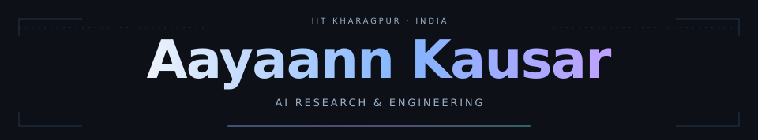
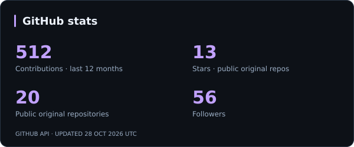
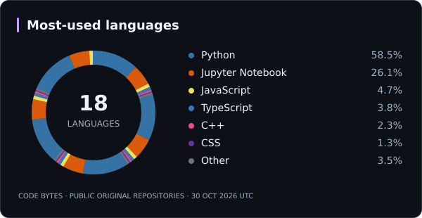

  <picture>
    <source media="(max-width: 600px) and (prefers-color-scheme: light)" srcset="assets/identity/masthead-mobile-light.svg">
    <source media="(max-width: 600px)" srcset="assets/identity/masthead-mobile.svg">
    <source media="(prefers-color-scheme: light)" srcset="assets/identity/masthead-light.svg">
    
  </picture>

  <picture>
    <source media="(prefers-reduced-motion: reduce)" srcset="assets/coding-illustration.png">
    
  </picture>

  <strong>Understanding models. Building the systems around them.</strong> 
  I study how language models retain and adapt knowledge, and build AI systems 
  for speech, retrieval, and scientific reasoning.

  <a href="https://linkedin.com/in/aayaann-kausar-8b2813344/"><strong>LinkedIn ↗</strong></a> &nbsp; · &nbsp;
  <a href="https://ak-portfolio-website-two.vercel.app/"><strong>Portfolio ↗</strong></a> &nbsp; · &nbsp;
  <a href="#selected-work"><strong>Explore the work ↓</strong></a>

  

<picture>
  <source media="(prefers-reduced-motion: reduce) and (max-width: 600px)" srcset="profile/signal-mobile.svg">
  <source media="(prefers-reduced-motion: reduce)" srcset="profile/signal.svg">
  <source media="(prefers-color-scheme: light)" srcset="https://raw.githubusercontent.com/Akgithub2028/Akgithub2028/output/pacman-contribution-graph.svg">
  
</picture>

## Selected work

Research questions, working systems, and the evidence behind them.

<table width="100%">
<tr><td>

<h3><a href="https://github.com/Akgithub2028/SFP">Subspace Feature Preservation</a></h3>

Investigating catastrophic forgetting through activation drift. SFP preserves an ablation-ranked PCA subspace during sequential language-model fine-tuning.

<blockquote><strong>0.933 R²</strong> for drift prediction · <strong>0.699</strong> retention–plasticity harmonic score</blockquote>

Results on Qwen2.5-1.5B with 32 directions; LwF scores 0.631. Includes a conditional forgetting bound verified in <strong>Lean 4</strong>. Findings vary with model scale.

<code>PyTorch</code> <code>LoRA</code> <code>PCA</code> <code>Lean 4</code>

<a href="https://github.com/Akgithub2028/SFP/blob/main/paper/sfp.pdf"><strong>Read the paper ↗</strong></a> &nbsp; · &nbsp; <a href="https://github.com/Akgithub2028/SFP">Code</a> &nbsp; · &nbsp; <a href="https://github.com/Akgithub2028/SFP/tree/main/lean-sfp">Formal proofs</a>

</td></tr>
</table>

<table width="100%">
<tr><td>

<h3><a href="https://github.com/Akgithub2028/Real-Time-AI-Voice-Translator">Real-Time Voice Translator</a></h3>

Bidirectional translation across <strong>7 languages</strong>, with bilingual captions, streamed voice playback, and explicit speaker switching.

<blockquote><strong>Whisper → GPT-OSS 20B → ElevenLabs</strong> Streaming audio, translation, and speech synthesis.</blockquote>

AudioWorklet capture, stale-response filtering, and stage-level p50/p95 monitoring; <strong>27 backend tests</strong>. Deployed on Vercel and Render.

<code>Next.js</code> <code>FastAPI</code> <code>WebSockets</code> <code>Web Audio</code>

<a href="https://real-time-ai-voice-translator.vercel.app"><strong>Try the translator ↗</strong></a> &nbsp; · &nbsp; <a href="https://real-time-ai-voice-translator.vercel.app/status">Latency dashboard</a> &nbsp; · &nbsp; <a href="https://github.com/Akgithub2028/Real-Time-AI-Voice-Translator">Code</a>

</td></tr>
</table>

<table width="100%">
<tr><td>

<h3><a href="https://github.com/Akgithub2028/qwen-domain-finetuning">Qwen2.5 · QLoRA Fine-Tuning</a></h3>

Adapting Qwen2.5-1.5B on <strong>1,286 ML-systems examples</strong> with 4-bit NF4 and rank-16 adapters, evaluated across topics and difficulty levels.

<blockquote><strong>+30.42% relative ROUGE-L</strong> on 161 held-out tasks BERTScore F1: <strong>0.8187 → 0.8497</strong></blockquote>

Error analysis spans 48 topics and reports the <strong>14.2% of tasks that regressed</strong>, alongside aggregate gains.

<code>PyTorch</code> <code>PEFT</code> <code>TRL</code> <code>QLoRA</code>

<a href="https://github.com/Akgithub2028/qwen-domain-finetuning/tree/main/results"><strong>Explore the results ↗</strong></a> &nbsp; · &nbsp; <a href="https://github.com/Akgithub2028/qwen-domain-finetuning">Code and study</a>

</td></tr>
</table>

<table width="100%">
<tr><td>

<h3><a href="https://github.com/Akgithub2028/NexusAgent-Enterprise-Autonomous-Multi-Agent-Decision-Intelligence-Platform">NexusAgent</a></h3>

Evidence-grounded decision support across documents and relational data. LangGraph coordinates hybrid retrieval, MCP text-to-SQL, and answer review.

<blockquote><strong>96.25% retrieval Hit@1</strong> on 160 answerable synthetic queries <strong>1,941 unit tests</strong> · <strong>323 offline integration tests</strong></blockquote>

Milvus, BM25, rank fusion, and BGE reranking support retrieval. SQLGlot AST validation, read-only scopes, and query timeouts control SQL execution.

<code>LangGraph</code> <code>Milvus</code> <code>MCP</code> <code>SQLGlot</code>

<a href="https://github.com/Akgithub2028/NexusAgent-Enterprise-Autonomous-Multi-Agent-Decision-Intelligence-Platform/blob/main/docs/ARCHITECTURE.md"><strong>Explore the architecture ↗</strong></a> &nbsp; · &nbsp; <a href="https://github.com/Akgithub2028/NexusAgent-Enterprise-Autonomous-Multi-Agent-Decision-Intelligence-Platform/tree/main/artifacts/public-evaluation">Evidence</a> &nbsp; · &nbsp; <a href="https://github.com/Akgithub2028/NexusAgent-Enterprise-Autonomous-Multi-Agent-Decision-Intelligence-Platform">Code</a>

</td></tr>
</table>

<table width="100%">
<tr><td>

<h3><a href="https://github.com/Akgithub2028/Autonomous-AI-Co-Scientist">Autonomous AI Co-Scientist</a></h3>

Developing research hypotheses from literature through coordinated agents, iterative critique, and evidence retrieval.

<blockquote><strong>Review → Generate → Critique → Rank → Refine</strong> Literature-grounded hypotheses with Elo-based ranking.</blockquote>

LangGraph coordinates asynchronous workers; corrective RAG and persistent vector memory support evidence retrieval and final-report synthesis.

<code>Python</code> <code>LangGraph</code> <code>ChromaDB</code> <code>Docker</code>

<a href="https://github.com/Akgithub2028/Autonomous-AI-Co-Scientist"><strong>Explore the research workflow ↗</strong></a>

</td></tr>
</table>

## From models to infrastructure

My work connects model behaviour, application engineering, and the systems that run them.

| Focus | Tools & direction |
| :--- | :--- |
| **🟣 Model research** | Continual learning, PyTorch, Transformers, LoRA / QLoRA, PEFT, TRL, Lean 4 |
| **🔵 AI applications** | LangGraph, RAG, MCP, FastAPI, WebSockets, Next.js |
| **🟢 Software & cloud** | Python, C++, TypeScript, Linux, Docker, Kubernetes, Terraform, CI/CD, AWS, GCP |
| **🟠 Studying now** | CUDA, Triton, GPU kernels, profiling, efficient inference, and LLM serving |

## Competition & academics

<table width="100%">
<tr><td>

WUNDER FUND / HFT MARKET STATE FORECASTING

<h3>9th of 5,000+ competitors</h3>

<strong>Final R²: 0.3920</strong> · Forecasting over 1,000-step streaming sequences.

A four-layer, eight-head Transformer with masked autoencoding and temporal positional encodings. Optimized CPU inference with <code>torch.compile</code>, Numba kernels, and preallocated buffers.

</td></tr>
</table>

<strong>Academic achievements</strong> · Engineering entrance examinations, 2024

| Examination | Standing |
| :--- | :--- |
| JEE Main | Top **0.29%** |
| JEE Advanced | Top **3.2%** |
| WBJEE | Top **0.20%** |

## GitHub activity

  <picture>
    <source media="(prefers-color-scheme: light)" srcset="profile/stats-light.svg">
    
  </picture>

  <picture>
    <source media="(prefers-color-scheme: light)" srcset="profile/top-langs-light.svg">
    
  </picture>

---

  <strong>Interested in model research or building AI systems?</strong> 
  <a href="https://linkedin.com/in/aayaann-kausar-8b2813344/">Connect on LinkedIn ↗</a> &nbsp; · &nbsp; <a href="https://ak-portfolio-website-two.vercel.app/">Visit my portfolio ↗</a>

